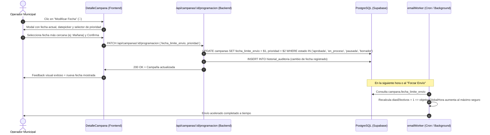

# Plan de Implementación: Modificación de Fecha Límite y Ritmo en Campañas Activas

## 1. Contexto y Diagnóstico del Sistema

En **3F Mailer**, el ritmo de despacho de correos se calcula dinámicamente en cada ciclo del worker SMTP (`src/services/emailWorker.ts`) a partir de la fecha límite de la campaña más urgente:

```typescript
// src/services/emailWorker.ts (líneas 120-130)
if (campana.fecha_limite_envio) {
  const fechaEvento = new Date(campana.fecha_limite_envio);
  const hoyDate = new Date();
  const diffTiempo = fechaEvento.getTime() - hoyDate.getTime();
  const diasRestantes = Math.ceil(diffTiempo / (1000 * 60 * 60 * 24));
  const diasEfectivos = diasRestantes <= 0 ? 1 : diasRestantes;

  // Calcula cuántos correos mandar por hora según los días restantes
  objetivoGlobalHora = Math.ceil(totalPendientes / (diasEfectivos * EJECUCIONES_DIARIAS));
}
```

Además, el orden de despacho de la cola da prioridad a las fechas más próximas:
```sql
ORDER BY 
  CASE WHEN c.prioridad = 'alta' THEN 1 ELSE 2 END ASC,
  c.fecha_limite_envio ASC NULLS LAST,
  ce.id ASC
```

### Situación Actual
Actualmente, el método `actualizarCampana` restringe cualquier modificación únicamente a campañas en estado `'borrador'` (`WHERE id = $id AND estado = 'borrador'`). Si un operador municipal aprueba una campaña con una fecha demasiado lejana por error (por ejemplo, 15 días en lugar de 2 días):
1. El cálculo arroja un `objetivoGlobalHora` muy bajo (pocos correos por hora).
2. El sistema no permite cambiar la fecha una vez aprobada o en proceso desde la interfaz ni desde la API.
3. El operador se ve forzado a pausar o cancelar y recrear todo el comunicado.

---

## 2. Garantía de Inocuidad: Por qué NO afecta las campañas existentes ni el sistema

| Aspecto | Garantía |
| :--- | :--- |
| **Esquema de BD** | **0 migraciones necesarias.** Las columnas `fecha_limite_envio` y `prioridad` ya existen en la tabla `campanas`. |
| **Integridad de Cola (`cola_envios`)** | La tabla `cola_envios` no guarda una copia estática de la fecha; hace `JOIN campanas c ON ce.campana_id = c.id` en tiempo real. |
| **Correos ya enviados** | Los registros con `estado = 'enviado'` o `fallido` y sus estadísticas de tracking (aperturas/clicks) permanecen 100% intactos. |
| **Campaña viva** | No se tocan el asunto, cuerpo HTML, flyer ni destinatarios seleccionados, previniendo discrepancias de contenido. |
| **Reacción del Worker** | En la siguiente iteración del cron (o si se presiona "Forzar Envío"), el worker lee la nueva fecha inmediatamente y recalcula el lote por hora. |

---

## 3. Arquitectura de la Solución



---

## 4. Detalle de Cambios Propuestos

### A. Backend

1. **Nuevo Esquema de Validación (`src/schemas/campanaSchema.ts`)**:
   - `actualizarProgramacionSchema`:
     ```typescript
     export const actualizarProgramacionSchema = z.object({
       fecha_limite_envio: z.string().regex(/^\d{4}-\d{2}-\d{2}$/, 'Formato de fecha inválido (YYYY-MM-DD)'),
       prioridad: z.enum(['alta', 'media', 'baja']).optional(),
     });
     ```

2. **Nuevo Método en Capa de Servicio (`src/services/campanaService.ts`)**:
   - Función `actualizarProgramacionCampana(id, data)`:
     - Permite actualizar si el estado es `'borrador'`, `'aprobada'`, `'en_proceso'` o `'pausada'`.
     - Rechaza campañas finalizadas (`'completada'`, `'cancelada'`).
     - Realiza `UPDATE campanas SET fecha_limite_envio = $1, ... WHERE id = $X`.
     - Invalida caché de `/api/campanas` y `/api/stats`.

3. **Controlador y Rutas (`src/controllers/campanaController.ts` y `src/routes/campanaRoutes.ts`)**:
   - Endpoint: `PATCH /api/campanas/:id/programacion`.
   - Middleware: `requireAuth`, `requireRole(['admin', 'editor'])`, `validateSchema(actualizarProgramacionSchema)`.
   - Registro en auditoría con `registrarAccion`.

### B. Frontend

1. **API Client (`client/src/services/api.ts`)**:
   - Agregar método:
     ```typescript
     export async function actualizarProgramacionCampana(
       id: string, 
       data: { fecha_limite_envio: string; prioridad?: 'alta' | 'media' | 'baja' }
     ): Promise<ApiResponse<CampanaConStats>>
     ```

2. **Interfaz en `DetalleCampana.tsx`**:
   - En la sección del encabezado donde se muestra:
     `<Clock size={14} /> Límite: {formatDate(campana.fecha_limite_envio)}`
   - Si la campaña está en `['aprobada', 'en_proceso', 'pausada', 'borrador']` y el usuario tiene permisos `puedeEditar`:
     - Mostrar botón/icono de edición: `[ ✏️ Cambiar Fecha / Ritmo ]`.
   - **Modal de Modificación**:
     - Datepicker con `min={hoy}` para asegurar que no se ingrese una fecha del pasado.
     - Selector de Prioridad (Alta / Media / Baja).
     - Mensaje informativo: *"Adelantar la fecha aumentará automáticamente la velocidad de envíos por hora del worker para entregar todos los correos antes del límite."*
     - Botones "Cancelar" y "Guardar Cambios".
   - Al guardar: actualiza el estado local de la campaña sin necesidad de recargar la página.

---

## 5. Matriz de Impacto y Seguridad

| Riesgo | Probabilidad | Mitigación |
| :--- | :---: | :--- |
| **Colisión de envíos en cola** | Nula | Los envíos pendientes siguen ordenados por ID y fecha; el worker simplemente toma lotes más grandes por hora. |
| **Saturación del servidor SMTP** | Nula | El worker ya cuenta con un techo fijo `maxGlobalPorHora` (calculado sobre el pool de cuentas activas). Jamás superará el límite del proveedor de correo. |
| **Modificación accidental de contenido** | Nula | El nuevo endpoint solo acepta `fecha_limite_envio` y `prioridad`. Asunto, cuerpo, links y destinatarios quedan blindados. |
| **Campañas ya finalizadas** | Nula | Si `estado` es `'completada'` o `'cancelada'`, la API rechaza la edición con código 422. |

---

## 6. Pasos de Ejecución

1. **Paso 1**: Crear el schema Zod `actualizarProgramacionSchema` en el backend.
2. **Paso 2**: Implementar `actualizarProgramacionCampana` en `campanaService.ts` y el endpoint en `campanaController.ts` / `campanaRoutes.ts`.
3. **Paso 3**: Agregar `actualizarProgramacionCampana` a `client/src/services/api.ts`.
4. **Paso 4**: Implementar el modal interactivo de cambio de fecha y ritmo en `client/src/components/DetalleCampana.tsx`.
5. **Paso 5**: Verificar tipos con `npx tsc --noEmit` en backend y `npm run build` en frontend.
